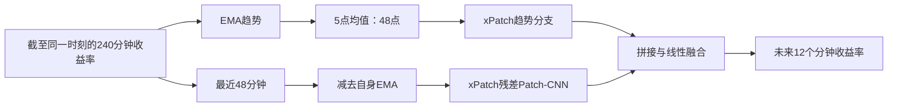

# xPatch-LS：日内长短历史双流

以根目录原版 xPatch 为底座。长流观察240分钟收益率，以因果EMA提取趋势，按5分钟均值压缩为48点；短流观察最近48分钟自身EMA的残差。复用原趋势MLP、残差Patch-CNN及拼接线性融合，预测未来12个单分钟对数收益率。主方案与原版48分钟模型的参数量相同。



## 本轮结果

实现和 92 个运行的独立验收已完成。当前压缩双流未稳定优于原版，详见 [验收与结果](RESULTS.md)。

## 安装与运行

从仓库根目录运行，建议使用独立虚拟环境。GPU需要支持本机GPU架构的PyTorch及兼容驱动。

```bash
python -m pip install -r requirements-finance.txt
python -m pytest tests/test_finance_ls.py -q
python -m finance_ls.run --stage audit
python -m finance_ls.run --stage validate
python -m finance_ls.run --stage freeze
python -m finance_ls.run --stage test
python -m finance_ls.run --stage report
python -m finance_ls.verify
```

也可用 `python -m finance_ls.run --stage all` 按上述顺序执行。配置为 `configs/finance_ls.json`，工件默认保存于 `artifacts/finance_ls`。参数 `--config` 与 `--output` 可指定独立实验。退出后使用原命令恢复已完成运行；未完成的单次训练会从同一种子重新开始。

配置、源代码、数据哈希变动时必须使用新的输出目录。冻结后不重新选择结构、随机种子或训练轮数；测试指标用于报告。若根据测试结果开发下一版，应使用新的未见数据验证，不能将同一测试集再次视为独立检验。

## 协议

- 只取 `close` 构造 `log(close[t]/close[t-1])`；37列指标、绝对价格和OBV不进入目标。不截断价格、不回填。
- 240个历史收益率需要241个连续收盘价；历史和未来均必须为精确连续分钟、处于提供时间轴的同一日期。所有模型共享最长历史定义的预测时刻。
- CSV的时区、行情来源和复权方式未确认，使用提供的日期边界，不过滤常规时段。不能将该数据审计理解为已经确认的交易所会话。
- 按全部源日期排序，末20%日期（向上取整）为测试集。前80%的40%作为第一折初始训练段，余下60%分为三段验证，逐折扩展训练。
- 每折只用训练日期内有效收益率拟合标准差，`ddof=0`、不减均值、关闭RevIN；不对两流分别拟合尺度。历史窗口可重叠，划分间未来标签不得重叠。
- 训练损失为12个分钟收益率的平均平方误差；选择指标为12分钟累计收益率MSE。Adam、学习率0.001、批大小128、最多30轮、早停耐心5；三个种子2026/2027/2028。
- 最终模型在全部开发日期上重训；各模型训练轮数为所有验证折和种子的最佳轮数中位数（四舍五入）。原版强基线仅由验证MSE选择，按样本数加权。
- 零收益、固定 `alpha=1` 的岭回归只运行一次；岭回归接收完整240分钟历史，预测12个单分钟收益率。
- 统计汇总平均各种子的**损失**，不平均预测组成集成。按完整日期成对bootstrap 5000次，保留日内重叠样本；置信区间不涵盖跨日相关或全部训练随机性的联合不确定性。
- “支持长短双流有效”要求相对零预测、岭回归及验证集选定的原版模型均改善，所有种子差异为负，日分块95%区间上界也为负。消融为探索性结果，不使用其测试结果选择主结构。

## 对照模型

| 配置名 | 定义 |
|---|---|
| `zero` / `ridge` | 零收益 / 240分钟岭回归 |
| `xpatch48` / `xpatch240` | 原xPatch的48 / 240分钟历史，金融管线统一预处理 |
| `ls` | 主方案：240趋势→48点 + 48残差 |
| `ls_unpooled` | 长流保留240点，其余同主方案 |
| `ls_no_decomp` | 两流直接接收对应原始收益率历史，长流仍做5点均值 |
| `long_only` / `short_only` | 独立重训的长流 / 短流；输出头直接预测，无未使用参数 |

`xpatch48`、`xpatch240` 是固定默认协议下的原架构基线，没有宣称经过全面超参数搜索。`ls_no_decomp` 仍有长流均值压缩，因此它检验的是EMA的增量作用，不是完全无滤波。每个窗口独立初始化EMA，长短流都不接触预测时刻之后的数据。

## 工件与接口

- `manifest.json`：完整配置、源码哈希、数据SHA256、环境；`audit.json`：日期覆盖率、缺口及来源限制；`splits.json`：精确日期划分。
- `frozen.json`：验证指标、固定训练轮数、预选原版模型；测试开始前生成。
- 各运行目录：缩放器、划分、训练历史、最佳/最终检查点、`predictions.npz`、指标及推理资源统计。
- `REPORT.md` / `summary.json`：1/5/12分钟MAE、RMSE、MSE、零预测改善、种子差异、日分块区间、消融解释、参数量与资源消耗。
- `acceptance.json`：独立重读源数据与每次运行，验证真实目标、训练段尺度、划分、所有保存预测的权重复现，以及训练后CPU/GPU数值一致性。

```python
from finance_ls.models import XPatchLS
from finance_ls.run import load_checkpoint

# 模型输入：[B,240,1]，为训练尺度下的收益率；输出：[B,12,1]。
model, checkpoint = load_checkpoint("artifacts/finance_ls/test/ls_seed2026/checkpoint.pt")
# 对新收益率除以 checkpoint['scaler']['std']，预测后乘回同一数值。
```

核心层兼容性：`Network` 原五个参数仍有效，新增可选 `trend_seq_len` 和 `streams`；默认前向路径与历史实现逐元素一致。EMA替换为等价因果权重计算，支持CPU/GPU及输入dtype，消除硬编码CUDA和除以极小幂的风险。其他旧脚本的数据问题不会因新增管线而自动修复，金融研究请使用上述入口。

参考：[xPatch，AAAI 2025](https://doi.org/10.1609/aaai.v39i19.34270)、[WPMixer，AAAI 2025](https://doi.org/10.1609/aaai.v39i18.34156)、[TimeBridge，ICML 2025](https://github.com/Hank0626/TimeBridge)。长短尺度本身不是新的研究贡献，实验结论以报告为准。
