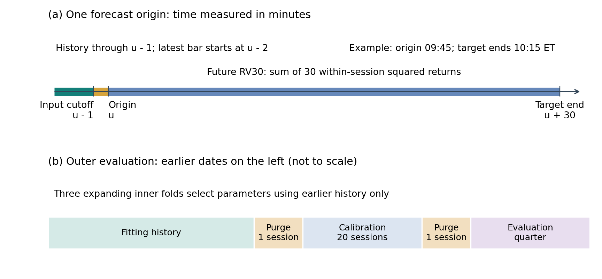
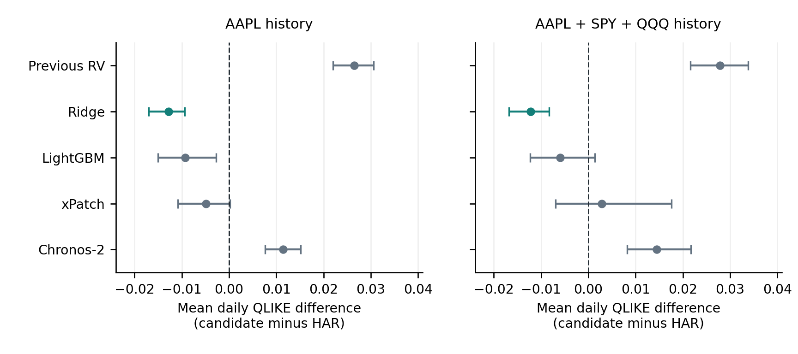
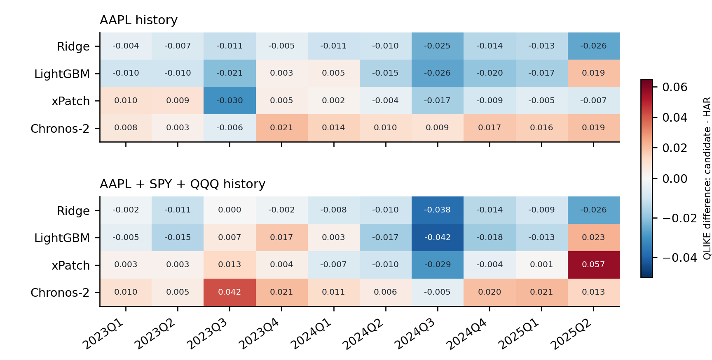

# Forecasting 30-Minute AAPL Realized Variance: Temporal Stability and Calibration Across Model Families

Wang Yang

High School Affiliated to Shanghai Jiao Tong University

Shanghai 200439, China

Corresponding author's e-mail: ____________________

## Abstract

Short-horizon variance forecasts require both accurate predictions and stable behavior across time. We examine these properties for AAPL's future 30-minute realized variance using minute OHLCV data from January 2021 to June 2026. We compare HAR, Ridge, LightGBM, xPatch, a fixed Chronos-2 checkpoint, and a previous-variance reference under two historical input panels. Ten quarterly expanding-window evaluations use nested temporal model selection, separate calibration windows, and whole-session purge gaps. We evaluate session-weighted QLIKE, dependence-adjusted comparisons, temporal stability, and empirical calibration. Across 602 development sessions, Ridge lowers QLIKE relative to the corresponding HAR by 7.74% with AAPL inputs and 7.41% with additional market history. Both specifications satisfy the fixed joint qualification rule. AAPL-only LightGBM improves aggregate QLIKE by 5.58% but fails annual-segment and seed stability requirements; xPatch's 2.97% mean improvement does not survive the joint statistical requirements. Ridge's advantage continues in 251 subsequent historical sessions, with improvements of 6.29% and 7.97%. However, lower point loss does not ensure adequate interval coverage within each period. The comparison supports evaluating accuracy, stability, and calibration separately. Its conclusions concern one target asset, previously exposed historical periods, and the evaluated representations and search budgets; prospective performance and economic value remain open.

**Keywords:** realized variance; intraday forecasting; temporal validation; forecast calibration; regularization; xPatch

## 1. Introduction

Forecasts of intraday variance describe the scale of future price fluctuations and can inform the design of risk-sensitive decisions. The statistical task differs from predicting the sign of a return: a large forecast variance is compatible with either an upward or downward price move. For a short horizon, a useful forecast must also respond to persistence and the trading clock without relying on observations that become available after its forecast origin. These requirements make the timing of inputs and labels part of the forecasting problem.

Realized-volatility research links high-frequency returns to observable measures of price variation [1]. HAR models summarize persistence over multiple time scales [2], while intraday periodicity motivates explicit treatment of the time of day [3]. Flexible regressors, deep sequence models, and pretrained forecasting models offer alternative representations. Their performance on broad benchmarks leaves an application-specific question: which of their evaluated implementations provides a stable improvement for a single equity's short intraday variance horizon?

Average prediction loss alone gives an incomplete answer. A model can improve a pooled score while deteriorating during one segment of the evaluation period. Neighboring minute forecasts share most of their future returns, so an apparent abundance of forecast origins does not imply a correspondingly large independent sample. A forecast can also perform well under a point loss while its prediction intervals under-cover a particular period. Assessing these properties separately avoids treating one favorable ranking as evidence for every intended use.

We study AAPL's realized variance over the next 30 minutes, with forecast origins every minute. The comparison includes a previous-RV reference, a tuned intraday HAR specification, Ridge, LightGBM, xPatch, and a fixed-weight Chronos-2 implementation. We ask three questions. **RQ1:** Which candidates improve QLIKE relative to their corresponding HAR under a fixed qualification rule? **RQ2:** Do these improvements persist across quarters, annual segments, and the prescribed random seeds? **RQ3:** Do point-loss and calibration diagnostics support the same assessment?

The study contributes a temporally structured empirical comparison and an analysis of disagreements between these evaluation criteria. We use ten expanding quarterly outer folds, three inner temporal folds, separate calibration tails, paired evaluation origins, and session-level inference. We retain every candidate in the development comparison and evaluate only qualified candidates in a later historical confirmation period. The results show a consistent QLIKE advantage for Ridge, a pooled improvement without sufficient stability for AAPL-only LightGBM, and differences between point-loss and calibration assessments.

The scope is a single-target historical study. AAPL remains the target when SPY and QQQ history is included. Input representations and model-specific search budgets differ, so the comparison does not identify a causal effect of architecture or complexity. The historical dates had already been exposed within the wider project. Temporal separation protects each model fit from future observations, but it does not make these periods an untouched blind test. These boundaries guide the interpretation of all three research questions.

## 2. Related work

**Realized variance and forecast evaluation.** Andersen et al. [1] provide the realized-volatility context, and Corsi [2] motivates a parsimonious multiscale benchmark. We adapt a HAR-type regression to a 30-minute intraday target with calendar terms; we do not claim an exact replication of the original daily specification. Positive and negative semivariance features follow the broader signed-variation motivation in Patton and Sheppard [5]. Minute sampling and calendar alignment do not establish that our realized-variance proxy equals latent integrated variance or eliminates market-microstructure effects.

Patton [4] studies forecast comparison with imperfect volatility proxies and conditions under which losses preserve forecast rankings. This motivates attention to the loss function as well as the target. We use QLIKE on the variance scale and retain log-RV MSE as a secondary diagnostic. Log-RV MSE is not the level-variance MSE considered in proxy-robustness arguments. Choosing QLIKE does not certify the historical bars as point-in-time observations or establish the required proxy assumptions for this dataset.

**Model families and comparison design.** Ridge [9] regularizes a linear predictor, while LightGBM [10] provides a gradient-boosted tree implementation. xPatch [7] combines exponential seasonal-trend decomposition with linear and nonlinear streams and channel-independent processing. Chronos-2 [8] supplies a pretrained forecasting comparison. We evaluate the retained implementations and search spaces; the original papers' benchmark results do not establish their performance on this RV30 task.

Benchmarking research illustrates why a comparison should explain its datasets, selection procedure, and failure modes. AMLB [13], for example, analyzes predictive performance, resource trade-offs, and framework failures across many classification and regression tasks. Our financial time-series setting requires chronological rather than ordinary independent-data validation, and its single target offers much narrower generalization evidence. We adopt the emphasis on transparent comparison conditions without treating the two settings as statistically equivalent.

**Dependence and calibration.** Diebold–Mariano comparisons [6], HAC covariance estimation [11], and Holm adjustment [12] provide the context for inference under serial dependence and multiple comparisons. We apply a prespecified session-level procedure because the minute labels overlap. For uncertainty assessment, Pacchiardi et al. [14] evaluate deterministic accuracy and probabilistic calibration separately, and Gibbs and Candès [15] investigate local coverage under distribution shifts. Our empirical residual intervals implement neither of their methods and inherit none of their theoretical guarantees. Their distinction between error and coverage motivates reporting both properties here.

## 3. Forecasting task and data

### 3.1. Target and information timing

Let \(c(t)\) denote the close of a one-minute bar ending at \(t\). For adjacent bars in the same trading session, define

\[
r(t)=\log c(t)-\log c(t-1\text{ min}).
\]

At minute origin \(u\), the forecast target is

\[
y_u=RV_{30}(u)=\sum_{k=1}^{30}r(u+k\text{ min})^2.
\]

All 30 returns must exist, be adjacent, and remain within that session. Overnight returns, the first bar of a session, and returns crossing missing bars do not supply valid adjacent intraday returns. Forecast origins run from 09:45 Eastern Time to the actual close minus 30 minutes, inclusive. A full regular session has 346 scheduled origins; early closes have fewer.

Inputs end at \(u-1\) minute. Since the supplier labels a bar by its start, the latest permitted bar starts at \(u-2\) minutes. A forecast at 09:45 may therefore use the bar starting at 09:43 and ending at 09:44. The one-minute buffer separates the input cutoff from the origin. It defines an admissible information set without proving that each historical bar arrived before that cutoff.

**Figure 1.** Forecast timing and chronological evaluation. The upper panel shows the one-minute input buffer and the subsequent 30-minute target. The lower panel shows a fitting window, a separate 20-session calibration tail, and one-session purge gaps before calibration and evaluation. Inner selection uses three expanding temporal folds within the available outer training history. The diagram represents the evaluation design, not measured historical publication times.

### 3.2. Coverage, inputs, and eligibility

We use Alpaca SIP historical minute OHLCV bars with raw adjustment from 4 January 2021 to 30 June 2026. The regular-session grid follows the New York Stock Exchange calendar in `America/New_York`, including daylight-saving transitions and early closes. The retained period contains 1,378 sessions and 535,620 expected bars per asset.

| Asset | Expected bars | Observed bars | Missing | Role |
|---|---:|---:|---:|---|
| AAPL | 535,620 | 535,620 | 0 | Target/input |
| SPY | 535,620 | 535,611 | 9 | Market input |
| QQQ | 535,620 | 535,620 | 0 | Market input |

The nine missing SPY bars remain missing. We reconstruct the retained tables from the paginated raw responses and check the supplied fields and selected unusual sessions. An overlapping subset of AAPL prices received an additional source check; equivalent independent verification is incomplete for SPY, QQQ, and volume. Historical final bars may include revisions and do not identify their original arrival times.

The AAPL panel uses AAPL history. The market panel also supplies SPY and QQQ history, with architecture-specific handling described below. Both panels use common eligible evaluation origins, requiring the AAPL future label and the historical inputs of all three assets. Future SPY and QQQ labels do not determine evaluation eligibility. Auxiliary training labels have separate eligibility checks. Long contexts and 22-session aggregates impose additional history requirements. A retained historical session can contain fewer than all scheduled origins; its mean loss uses the eligible subset.

Development spans 2023Q1–2025Q2 and contains 602 eligible sessions and 207,235 origins per model. Historical confirmation spans 2025H2–2026H1 and contains 251 sessions and 86,306 origins. The earlier data supply fitting history. These counts describe the evaluated sample after eligibility rules, rather than the entire source calendar.

## 4. Models and evaluation protocol

### 4.1. Predictors and representations

The previous-RV reference uses the latest known 30-minute RV with a fitting-window seasonal-ratio adjustment. HAR/HAR-X uses a prespecified multiscale feature subset. Ridge and LightGBM search compact or richer feature sets containing lagged 5-, 15-, 30-, 60-, and 120-minute variation, previous-session and 5-/22-session aggregates, semivariances, returns, historical volume/range measures, and trading-clock terms. All features end at the same allowed cutoff. Scaling and seasonal profiles use fitting observations only.

For Ridge, with transformed target \(z\) and standardized feature matrix \(X\), we fit

\[
(\widehat b,\widehat\beta)
=\arg\min_{b,\beta}\{\|z-b-X\beta\|_2^2+\lambda\|\beta\|_2^2\},
\]

retaining an intercept and using an SVD solver. LightGBM searches tree size, minimum leaf samples, learning rate, sampling, and regularization under the fixed inner procedure. HAR is also tuned; it is not an untreated default comparator.

Sequence models receive the history of trailing RV30 in log or log seasonal-ratio form. The most recent known trailing value ends at \(u-1\) minute. They predict 31 steps and use the last: the trailing 30-minute RV ending at \(u+30\) minutes equals the required future target. Using the 30th step would produce a different window. Training targets remain inside the permitted session and temporal partition.

xPatch retains the original architecture, with EMA/DEMA decomposition options supported by the implementation. Its market panel learns auxiliary asset tasks through shared channel-independent parameters; it does not add a cross-channel fusion layer to the AAPL output. Tabular models instead receive market features as conditional inputs. Chronos-2 uses a fixed checkpoint revision and file identities, and disables cross-learning between separate forecast origins. Thus, the two panels are not identical architectural ablations across families.

### 4.2. Selection, calibration, and confirmation

Each quarterly outer fold uses earlier dates for selection and fitting. Before the outer quarter, we reserve a 20-session calibration tail, with one whole-session purge gap on each side. Three expanding inner folds contain non-overlapping 20-session validation blocks and apply the same separation between fitting, calibration, and validation. We discard labels crossing a partition boundary.

Training origins follow a fixed five-minute stride, inner validation a ten-minute stride, and calibration and outer evaluation a one-minute stride. These clock-based rules reduce duplicated work from overlapping labels without selecting origins according to target values. Model selection minimizes session-weighted inner QLIKE.

| Model | Configurations | Inner selection |
|---|---:|---|
| Previous RV | 1 fixed | No search |
| HAR/HAR-X | 12 | Penalty, semivariances, representation |
| Ridge | 32 | Eight penalties, two feature sets, two representations |
| LightGBM | 80 | Fixed random search; inner early stopping |
| xPatch | 32 | Supported context, patch, decomposition, training settings |
| Chronos-2 | 8 | Four contexts, two representations; fixed weights |

LightGBM and xPatch screen configurations with seed 2026, then reevaluate the top three using 2027 and 2028 on all three inner folds. xPatch applies successive halving at cumulative epoch limits 5, 15, and 30, retaining 32, 16, and 8 configurations. Optimizer and random states carry forward. Inner outcomes determine final training duration; outer labels do not control early stopping. These are model-specific search budgets with different computational costs.

For a positive raw variance forecast \(q_u\), the disjoint calibration set \(\mathcal C\) supplies log residuals \(e_j=\log y_j-\log q_j\). We obtain the point forecast and empirical interval endpoints from

\[
a=|\mathcal C|^{-1}\sum_{j\in\mathcal C}\exp(e_j),
\qquad \widehat y_u=a q_u,
\]

\[
\widehat I_u(\alpha)
=q_u[\exp(Q_{\alpha/2}(e)),\exp(Q_{1-\alpha/2}(e))].
\]

Here \(Q\) denotes an empirical quantile. For seasonal-ratio predictions, \(q_u\) already includes the fitting-window seasonal expectation at the future calendar positions. Calibration weights eligible origins equally; evaluation weights sessions equally. These empirical intervals have no distribution-free coverage guarantee.

Formal LightGBM and xPatch point forecasts average the three individually calibrated variance means. Their ensemble intervals use calibration log residuals around this arithmetic mean without altering the point forecast. Deterministic models do not receive redundant seed runs. The search record contains 100 tuned groups and 12,000 inner jobs, or 120 groups and 12,200 jobs including fixed references and formal outer prediction jobs. The supplement describes the retained ledger and replay scope.

Only development-qualified candidates enter historical confirmation with their corresponding HAR baselines. We retain the last development fold's selected configuration, refit using only pre-confirmation data under the same purge/calibration rules, and run no new search. This conditional design cannot supply later-period rankings for models that were not admitted.

### 4.3. Loss, dependence, and joint qualification

With a floor \(\varepsilon=10^{-12}\), let \(\widetilde y=\max(y,\varepsilon)\) and \(\widetilde p=\max(p,\varepsilon)\). The primary loss is

\[
L(y,p)=\frac{\widetilde y}{\widetilde p}
-\log\!\left(\frac{\widetilde y}{\widetilde p}\right)-1.
\]

For eligible origins \(\mathcal U_d\) in session \(d\), we compute

\[
\overline L_{m,d}=|\mathcal U_d|^{-1}
\sum_{u\in\mathcal U_d}L(y_u,\widehat y_{m,u}),
\]

then average \(\overline L_{m,d}\) equally across sessions. Early-close sessions receive the same aggregate weight as full sessions. Relative improvement is \(100(1-\overline L_m/\overline L_{HAR})\). Negative values indicate higher loss than the matching HAR.

Paired daily differences are \(D_{m,d}=\overline L_{m,d}-\overline L_{HAR,d}\). We use a one-sided DM/HAC comparison with five session lags and Bartlett weights, plus single-session and circular five-session bootstrap with 5,000 replicates each. Uncentered bootstrap differences yield two-sided percentile intervals; centered differences yield null tail probabilities. Blocks follow observed eligible sessions without inserting artificial zero-loss dates.

For each comparison, we take the maximum of the three p-values and apply Holm adjustment to the fixed family of ten candidate/panel comparisons. Qualification requires lower QLIKE, adjusted p below 0.05, negative upper endpoints for both 95% bootstrap intervals, improvement in at least 7/10 quarters, improvement in each of 2023, 2024, and 2025H1, and pooled/annual improvement for every prescribed seed. Confirmation retains the corresponding statistical requirements, at least 3/4 improving quarters, and improvement in both half-year segments. These additional stability requirements form a decision rule; they are not separate proofs of uniform predictive superiority.

### 4.4. Calibration diagnostics and study status

We report log-RV MSE, empirical 80%/90% coverage and mean width with equal session weights. We also fit the descriptive daily-mean regression

\[
\overline y_d=a_{MZ}+b_{MZ}\overline{\widehat y}_d+\epsilon_d,
\]

using HAC covariance with five session lags. Its daily observations average overlapping intraday targets and forecasts. A slope near one alone does not establish calibration: the intercept, uncertainty, aggregation, and omitted conditional behavior also matter. We report saved coefficient estimates and standard errors without introducing a new joint hypothesis test.

The evaluation rules and configuration identities were signed locally before the formal RV30 outer evaluation; this is not independent public preregistration. The three RQs organize the present analysis after results were known. Existing historical exposure and uncertain checkpoint pretraining boundaries remain. Neither the narrative organization nor numerical replay converts the study into an unexposed test.

## 5. Historical empirical results

### 5.1. RQ1: Average loss and statistical qualification

Ridge achieves the lowest development QLIKE in both panels. Its AAPL-only loss is 0.152919 against HAR's 0.165755, a 7.74% improvement. With market history, its loss is 0.152271 against 0.164462, a 7.41% improvement. Both comparisons have Holm p = 0.0019996 and satisfy the joint qualification rule.

| Inputs | Model | QLIKE | Log-RV MSE | Gain (%) | Holm p | All gates |
|---|---|---:|---:|---:|---:|---|
| AAPL | Previous RV | 0.192281 | 0.345949 | −16.00 | 1 | Fail |
| AAPL | HAR | 0.165755 | 0.286719 | Reference | — | Reference |
| AAPL | Ridge | 0.152919 | 0.257131 | 7.74 | 0.0019996 | Pass |
| AAPL | LightGBM | 0.156501 | 0.251059 | 5.58 | 0.0136551 | Fail |
| AAPL | xPatch | 0.160833 | 0.270772 | 2.97 | 0.330452 | Fail |
| AAPL | Chronos-2 | 0.177211 | 0.308747 | −6.91 | 1 | Fail |
| Market | Previous RV | 0.192281 | 0.345949 | −16.91 | 1 | Fail |
| Market | HAR-X | 0.164462 | 0.289572 | Reference | — | Reference |
| Market | Ridge | 0.152271 | 0.257211 | 7.41 | 0.0019996 | Pass |
| Market | LightGBM | 0.158525 | 0.259838 | 3.61 | 0.330452 | Fail |
| Market | xPatch | 0.167298 | 0.276986 | −1.72 | 1 | Fail |
| Market | Chronos-2 | 0.178908 | 0.310045 | −8.78 | 1 | Fail |

The five-session block intervals for Ridge minus HAR are [−0.017024, −0.009415] and [−0.016843, −0.008327]. Figure 2 places these paired effects alongside all other candidates. The intervals themselves are pointwise; multiplicity enters through the separate Holm criterion.

**Figure 2.** Mean daily QLIKE differences and pointwise 95% five-session bootstrap intervals. Negative differences favor the candidate over its matching HAR. Green marks candidates satisfying all fixed qualification requirements. The two panels use distinct HAR comparators; their separate significance results do not test the difference between the two Ridge forecasts.

AAPL-only xPatch improves mean QLIKE by 2.97%, but its five-session interval [−0.010903, 0.000159] includes zero and its adjusted p is 0.330452. Thus, a favorable mean alone does not establish improvement under the protocol. Chronos-2 incurs higher QLIKE than HAR in both panels. This finding applies to its fixed checkpoint, representation, calibration, and eight searched configurations, rather than to pretrained forecasting as a whole.

The market Ridge has slightly lower numerical QLIKE than AAPL-only Ridge. The registered comparisons test each against its own HAR, so we cannot attribute a statistically established incremental gain to SPY and QQQ. The absence of a uniform market-panel benefit across families further limits a simple interpretation of additional assets as universally helpful inputs.

### 5.2. RQ2: Temporal and seed stability

The distinction between pooled performance and temporal stability is most visible for LightGBM. In the AAPL panel it improves QLIKE by 5.58%, has adjusted p = 0.013655, and has both bootstrap intervals below zero. It also improves in 7/10 quarters. However, its improvement turns negative in 2025H1, so it fails the annual-segment requirement.

| Inputs | Model | 2023 gain (%) | 2024 gain (%) | 2025H1 gain (%) | Better quarters | Seed rule |
|---|---|---:|---:|---:|---:|---|
| AAPL | Ridge | 4.48 | 8.93 | 10.57 | 10/10 | Pass |
| AAPL | LightGBM | 6.06 | 8.63 | −0.78 | 7/10 | Fail |
| AAPL | xPatch | 1.35 | 4.08 | 3.41 | 6/10 | Fail |
| AAPL | Chronos-2 | −4.52 | −7.60 | −9.32 | 1/10 | Fail |
| Market | Ridge | 2.32 | 10.17 | 9.56 | 9/10 | Pass |
| Market | LightGBM | −1.57 | 10.87 | −2.69 | 6/10 | Fail |
| Market | xPatch | −3.94 | 7.32 | −15.72 | 4/10 | Fail |
| Market | Chronos-2 | −13.92 | −4.65 | −9.20 | 1/10 | Fail |

Each of the three LightGBM seeds has a positive 2025H1 loss difference against HAR: 0.001292, 0.001798, and 0.001914. The deterioration therefore appears across all prescribed seeds. These repeats measure sensitivity to training randomness within one dataset; they do not constitute independent market replications.

**Figure 3.** Quarterly mean daily QLIKE differences relative to the matching HAR, for all ten development quarters. Blue cells favor the candidate and red cells favor HAR; values are descriptive differences. Both panels predict AAPL. The display retains periods of deterioration and does not test individual-quarter significance.

For AAPL-only xPatch, all three annual-segment ensemble means improve, but only 6/10 quarters improve. Moreover, the 2027 and 2028 seed predictions have positive 2023 differences of 0.000897 and 0.000673. Annual aggregation and seed aggregation can therefore conceal different failures. The market xPatch is more variable: its annual relative changes are −3.94%, +7.32%, and −15.72%.

Ridge improves in every AAPL-only quarter and nine market-panel quarters, and in all three annual segments. Its deterministic fit has no training-seed variability. These results support temporal consistency within the evaluated periods; they do not guarantee improvement in every future regime. The analysis locates instability but does not establish whether distribution changes, estimation variance, input representation, or another mechanism caused it.

### 5.3. RQ3: Point losses and calibration

Model rankings depend on which forecast property is assessed. AAPL-only LightGBM has lower log-RV MSE than Ridge, 0.251059 versus 0.257131, while Ridge has lower QLIKE. Because the losses weight prediction errors differently, we retain the prespecified variance-scale criterion instead of selecting a metric after observing this reversal.

| Inputs | Model | 80% coverage | 80% width | 90% coverage | 90% width |
|---|---|---:|---:|---:|---:|
| AAPL | Previous RV | 78.79% | 1.5071 | 89.31% | 2.1601 |
| AAPL | HAR | 79.12% | 1.1610 | 88.83% | 1.6126 |
| AAPL | Ridge | 79.33% | 1.4147 | 88.88% | 1.9232 |
| AAPL | LightGBM | 79.40% | 0.9966 | 88.90% | 1.3708 |
| AAPL | xPatch | 80.16% | 1.1575 | 89.59% | 1.5940 |
| AAPL | Chronos-2 | 79.63% | 1.2958 | 89.57% | 1.8322 |
| Market | Previous RV | 78.79% | 1.5071 | 89.31% | 2.1601 |
| Market | HAR-X | 78.89% | 1.1492 | 88.70% | 1.5827 |
| Market | Ridge | 78.66% | 1.2913 | 88.59% | 1.7851 |
| Market | LightGBM | 78.05% | 0.9894 | 88.01% | 1.3691 |
| Market | xPatch | 80.37% | 1.0791 | 89.45% | 1.4880 |
| Market | Chronos-2 | 79.43% | 1.3144 | 89.46% | 1.8565 |

Widths in Table 5 are multiplied by \(10^5\). Ridge's development intervals are wider than the corresponding HAR intervals, while AAPL-only xPatch has aggregate coverage closer to nominal and narrower intervals than Ridge. These observations address different objects from the mean-forecast QLIKE comparison. No uncertainty-adjusted interval-quality ranking was specified or established.

Period-specific results expose a limitation hidden by aggregate coverage. AAPL-only Ridge's 90% coverage is 88.76% in 2023, 90.48% in 2024, and 85.82% in 2025H1. During 2025H1, its QLIKE improves by 10.57%, while average 90% width is 4.7908 on the displayed scale, against HAR's 2.8996. Lower point loss thus coexists with under-coverage and greater width in that segment. HAR and xPatch also under-cover there, at 86.18% and 86.99%. The observations motivate local uncertainty diagnostics without identifying a particular source of miscalibration.

The daily-mean regression provides a further view. Development slopes for Ridge are 0.370 and 0.482, with positive intercepts; their later confirmation slopes are near one. Table 6 reports the coefficient estimates and saved HAC slope standard errors.

| Period | Inputs | Model | Intercept × 10⁵ | Slope | HAC SE(slope) |
|---|---|---|---:|---:|---:|
| Development | AAPL | HAR | −0.6158 | 1.616 | 0.191 |
| Development | AAPL | Ridge | 0.5850 | 0.370 | 0.025 |
| Development | Market | HAR-X | −0.6546 | 1.639 | 0.190 |
| Development | Market | Ridge | 0.4720 | 0.482 | 0.024 |
| Confirmation | AAPL | HAR | −0.2702 | 1.148 | 0.069 |
| Confirmation | AAPL | Ridge | −0.1431 | 1.049 | 0.057 |
| Confirmation | Market | HAR-X | −0.1867 | 1.037 | 0.054 |
| Confirmation | Market | Ridge | −0.1619 | 1.053 | 0.057 |

A slope below one in this observed-on-predicted regression describes its fitted relation; it does not by itself imply compressed forecast variance. Development pools quarterly refits, whereas confirmation uses one pre-period refit, so coefficient changes cannot be attributed solely to a change in calibration quality. We neither test a new joint intercept/slope hypothesis nor infer conditional or prospective calibration from these summaries.

### 5.4. Subsequent historical confirmation

Both qualified Ridge candidates retain lower QLIKE in the 251-session confirmation sample. They improve in all four quarters and pass the fixed confirmation requirements. The AAPL-only reduction is 6.29%; the market-panel reduction is 7.97%.

| Inputs | HAR QLIKE | Ridge QLIKE | Gain (%) | Holm p | Five-session 95% CI |
|---|---:|---:|---:|---:|---|
| AAPL | 0.175851 | 0.164782 | 6.29 | 0.0019996 | [−0.013920, −0.008246] |
| Market | 0.174630 | 0.160710 | 7.97 | 0.0019996 | [−0.017701, −0.009876] |

AAPL-only Ridge's 80%/90% coverage is 81.63%/90.90%, with mean widths 1.0291/1.4839 on the displayed scale. Market Ridge has 81.52%/90.56% coverage and widths 1.0471/1.4768. These remain descriptive historical diagnostics. Since only development-qualified candidates entered this stage, the results establish no confirmation-period superiority over the excluded model families. The previously exposed confirmation dates supply later-period consistency evidence with a fixed configuration, rather than independent blind or live validation.

## 6. Discussion

The three research questions lead to distinct conclusions. Ridge meets the aggregate and stability requirements in both panels. LightGBM's AAPL-only aggregate improvement fails the temporal requirements, and xPatch's favorable ensemble mean fails the joint statistical rule. Meanwhile, calibration diagnostics qualify the interpretation of Ridge's point-loss advantage. A model can be the preferred mean predictor under the fixed QLIKE rule without supplying sufficiently reliable intervals in each period.

Ridge's performance is consistent with the usefulness of regularization when engineered features already summarize persistence and the trading clock. This is an interpretation to test, not a demonstrated mechanism. The study does not isolate the effects of regularization, feature design, training sample size, or the choice of representation. A comparison of the same architecture with and without each component, on separately protected evaluation data, would be needed to support those attributions.

The stability rule changes the decision made from pooled significance. It rejects AAPL-only LightGBM despite its adjusted p below 0.05 because its 2025H1 deterioration conflicts with a stated requirement. That requirement embodies a preference for consistency across the selected segments. Different applications could justify other tolerances, but changing them after seeing these results would define a new selection problem. We retain the original rule and report the conflicting diagnostics.

The calibration findings also discourage collapsing uncertainty assessment into point-score selection. Empirical residual quantiles can deliver near-nominal aggregate coverage while missing within particular periods. Daily-mean regression discards intraday conditional structure, and average width alone does not quantify the cost of all coverage errors. Accordingly, these diagnostics identify limitations in the evaluated uncertainty outputs; they do not establish a uniformly superior probabilistic forecasting method.

## 7. Limitations and future work

**Generalization and comparability.** We evaluate one target asset and one horizon. SPY and QQQ history extends inputs or auxiliary training, not the number of independently evaluated targets. Model families differ in feature access, input representation, and search costs. The market panel has different structural effects on tabular models and channel-independent xPatch. A useful next study would evaluate AAPL, SPY, and QQQ as separate targets under explicitly matched available information, with chronological selection and a fixed comparison family. Because these assets are correlated, even that extension would not establish broad cross-market generalization.

**Historical and statistical boundaries.** Previously exposed dates, incomplete historical-arrival records, possible data revisions, and uncertain pretraining contamination limit interpretation. One-minute RV is an imperfect proxy, and calendar completeness does not ensure the absence of data defects. Daily aggregation addresses much of the intraday overlap but does not create independent sessions or eliminate all forms of nonstationarity. Bootstrap and HAC results depend on the fixed resampling and lag choices. Two local replay rounds check computation and saved artifacts; they are not independent-provider or external-laboratory replication.

**Controlled simulation.** A prospective supplement could test stable GARCH dynamics, predetermined variance shifts, and leverage or heavy-tailed innovations while retaining known generation rules. Matched innovation draws, independent generated paths, and locked development/test boundaries would allow analysis of whether average losses hide local deterioration. The simulation should report interval width alongside coverage and define recovery criteria before observing results. No such simulation results are included in the present study. Simulation would test behavior under the chosen processes; it would not establish the cause of the historical AAPL ranking or replace market validation.

**Timely prospective and economic validation.** The frozen models require evaluation on genuinely later, timely received data with actual issue timestamps. Free delayed SIP can support a separate shadow replay of the same market-time task, but generation after the origin cannot establish a forecast issued before its target window. Timely evaluation should preserve model identities and assess a fixed sample without interim score-based updates. Directional trading returns, transaction costs, spreads, slippage, and execution rules have not been evaluated. Historical variance-loss reductions cannot be converted into profitability claims. These are future empirical studies rather than missing values to infer from the current results.

## 8. Conclusion

For the evaluated AAPL RV30 task, tuned Ridge improves QLIKE over its corresponding HAR and meets the fixed stability requirements in development and later historical confirmation. AAPL-only LightGBM demonstrates that pooled statistical improvement can coexist with a failed temporal requirement. Calibration diagnostics show that even the preferred point predictor can under-cover an annual segment. The practical implication within this setting is to retain strong regularized baselines and assess average error, temporal stability, and uncertainty separately. The evidence remains historical and task-specific; matched-input, multi-target, simulated-mechanism, and timely prospective studies are needed for broader conclusions.

## Data and code availability

The local reproducibility package indexes the protocol, configurations, data and checkpoint identities, predictions, search ledger, and verification scope through `delivery/manifest.json`. The accompanying supplementary material describes table and figure reproduction and provides saved annual, seed, clock, and calibration diagnostics. Historical source bars require appropriate Alpaca access; redistribution rights are not established here. The project repository is https://github.com/wyyyyy-0121/xPatch, but this manuscript does not assert that its complete current local results and artifacts have been published there. The availability of a complete public replication package remains to be established before submission.

## References

[1] Andersen, T. G., Bollerslev, T., Diebold, F. X., and Labys, P. (2003). Modeling and Forecasting Realized Volatility. *Econometrica*, 71(2), 579–625. https://doi.org/10.1111/1468-0262.00418.

[2] Corsi, F. (2009). A Simple Approximate Long-Memory Model of Realized Volatility. *Journal of Financial Econometrics*, 7(2), 174–196. https://doi.org/10.1093/jjfinec/nbp001.

[3] Andersen, T. G., and Bollerslev, T. (1997). Intraday periodicity and volatility persistence in financial markets. *Journal of Empirical Finance*, 4(2–3), 115–158. https://doi.org/10.1016/S0927-5398(97)00004-2.

[4] Patton, A. J. (2011). Volatility forecast comparison using imperfect volatility proxies. *Journal of Econometrics*, 160(1), 246–256. https://doi.org/10.1016/j.jeconom.2010.03.034.

[5] Patton, A. J., and Sheppard, K. (2015). Good Volatility, Bad Volatility: Signed Jumps and the Persistence of Volatility. *Review of Economics and Statistics*, 97(3), 683–697. https://doi.org/10.1162/REST_a_00503.

[6] Diebold, F. X., and Mariano, R. S. (1995). Comparing Predictive Accuracy. *Journal of Business & Economic Statistics*, 13(3), 253–263. https://doi.org/10.1080/07350015.1995.10524599.

[7] Stitsyuk, A., and Choi, J. (2025). xPatch: Dual-Stream Time Series Forecasting with Exponential Seasonal-Trend Decomposition. *Proceedings of the AAAI Conference on Artificial Intelligence*, 39(19), 20601–20609. https://doi.org/10.1609/aaai.v39i19.34270.

[8] Ansari, A. F., Shchur, O., Küken, J., et al. (2025). Chronos-2: From Univariate to Universal Forecasting. arXiv:2510.15821. https://arxiv.org/abs/2510.15821.

[9] Hoerl, A. E., and Kennard, R. W. (1970). Ridge Regression: Biased Estimation for Nonorthogonal Problems. *Technometrics*, 12(1), 55–67. https://doi.org/10.1080/00401706.1970.10488634.

[10] Ke, G., Meng, Q., Finley, T., et al. (2017). LightGBM: A Highly Efficient Gradient Boosting Decision Tree. *Advances in Neural Information Processing Systems*, 30. https://www.microsoft.com/en-us/research/wp-content/uploads/2017/11/lightgbm.pdf.

[11] Newey, W. K., and West, K. D. (1987). A Simple, Positive Semi-Definite, Heteroskedasticity and Autocorrelation Consistent Covariance Matrix. *Econometrica*, 55(3), 703–708. https://doi.org/10.2307/1913610.

[12] Holm, S. (1979). A Simple Sequentially Rejective Multiple Test Procedure. *Scandinavian Journal of Statistics*, 6(2), 65–70. https://www.jstor.org/stable/4615733.

[13] Gijsbers, P., Bueno, M. L. P., Coors, S., LeDell, E., Poirier, S., Thomas, J., Bischl, B., and Vanschoren, J. (2024). AMLB: an AutoML Benchmark. *Journal of Machine Learning Research*, 25(101), 1–65. https://www.jmlr.org/papers/v25/22-0493.html.

[14] Pacchiardi, L., Adewoyin, R. A., Dueben, P., and Dutta, R. (2024). Probabilistic Forecasting with Generative Networks via Scoring Rule Minimization. *Journal of Machine Learning Research*, 25(45), 1–64. https://www.jmlr.org/papers/v25/23-0038.html.

[15] Gibbs, I., and Candès, E. J. (2024). Conformal Inference for Online Prediction with Arbitrary Distribution Shifts. *Journal of Machine Learning Research*, 25(162), 1–36. https://www.jmlr.org/papers/v25/22-1218.html.
