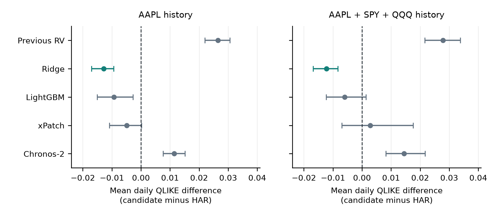
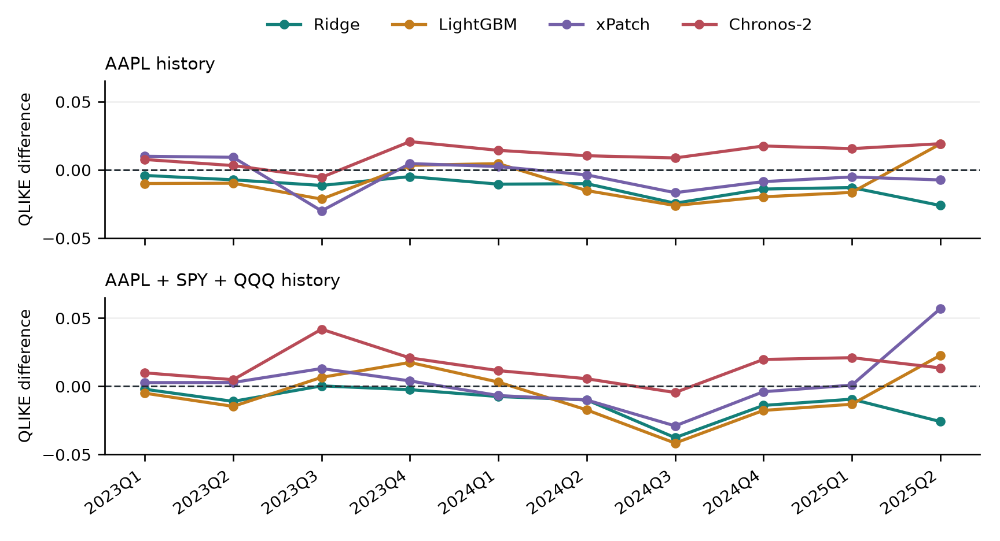

# AAPL 日内已实现方差预测的可复现比较：正则化回归、树模型与时序深度模型

中文核对稿，2026 年 11 月 4 日。用户已确认英文期刊或会议投稿，英文主稿见 `MANUSCRIPT_EN.md`；作者信息和具体投稿格式待定。本稿报告已完成的历史实验，免费延迟影子观察仍在收集阶段。数据与数值来源见同目录 `evidence.json` 和 `RESULTS.md`。

## 摘要

本文比较正则化回归、树模型和时序模型在 AAPL 日内已实现方差预测中的表现。研究使用 2021 年 1 月至 2026 年 6 月的 SIP 分钟 OHLCV 数据，每分钟预测随后 30 分钟同日对数收益的平方和，并分别评价 AAPL 历史信息集与加入 SPY、QQQ 的市场信息集。实验采用十季度扩展时间验证、三内折参数选择、隔离校准与交易日清除间隔，以日等权 QLIKE 为主指标，结合序列相关修正、日与五会话块 bootstrap 以及十项 Holm 校正判定预测增益。开发期包含 602 个合格会话、每模型 207,235 个起点。两个信息集的 Ridge 相对对应 HAR 基线分别降低 7.74% 和 7.41% 的 QLIKE，且通过全部预设门槛；xPatch 和固定权重 Chronos-2 未通过全部门槛。随后 251 个会话的历史确认中，Ridge 的相对改善分别为 6.29% 和 7.97%。AAPL 信息集的 LightGBM 虽取得显著的总体改善，年度与种子稳定性仍不足。结果表明，在本研究的任务、数据和搜索预算下，强正则化基线具有比较价值。研究范围限于单一目标资产，历史期间已有项目曝光，尚未完成及时前瞻验证；本文不据此推断交易盈利或其他资产上的普遍优势。

关键词：已实现方差；日内预测；Ridge；HAR；xPatch；时间序列验证

## 1 引言

分钟级股票预测包含不同任务。预测未来收益关注方向和幅度，预测已实现方差关注随后一段时间的波动程度。两者的标签、损失函数及经济用途不同。本项目早期曾比较 AAPL 的 12 分钟累计收益预测，候选均未通过相对零收益基线的开发门槛。本文另行定义 RV30 任务，保留早期阴性结果作为研究沿革，不把更换预测目标写成同一任务的性能改善。

已实现波动率研究为高频收益聚合与波动预测提供了方法基础 [1]。HAR 模型以不同时间尺度的信息描述波动持续性 [2]；日内季节性则要求研究者在比较预测模型时处理交易时钟和波动水平的关系 [3]。时序模型能够拟合更复杂的映射，但通用基准中的表现不能直接决定其在单只股票、较短预测跨度和特定评价尺度下的优势。

本文提出一个具体问题：在统一的信息截点、训练与校准纪律以及统计门槛下，Ridge、LightGBM、xPatch 和 Chronos-2 能否稳定改善 AAPL 未来 30 分钟已实现方差的预测？另一个问题是，加入 SPY 与 QQQ 的历史信息后，各模型相对相应 HAR 基线的结果如何变化？

本文的实证工作包括共同预测起点上的模型比较、参数搜索的记录和结果复核。研究者在正式 RV30 外层运行前对协议、配置、依赖和数据身份作了本地签名，但没有建立公共注册平台上的独立时间戳。历史数据也已有项目曝光。因此，本文将按时间切分的结果报告为回顾性样本外比较，保留对未接触样本的进一步验证要求。

## 2 相关研究与方法依据

Andersen 等 [1] 研究已实现波动率的建模与预测。本文采用分钟收益平方和作为观测目标，但不假设一分钟采样已消除市场微观结构噪声，也不将该目标直接等同于不可观测的潜在积分方差。Corsi [2] 的 HAR 提供多尺度基线；本文对其作了明确的任务适配，使用日内滚动 RV、过去会话聚合、季节性及可选半方差信息，不声称复现原文的全部设定。

Patton [4] 讨论不完美波动率代理下的预测比较。本文据此重视评价尺度和损失选择，使用原方差尺度的 QLIKE。其稳健排序结论依赖假设，不能用来豁免行情修订、缺失分钟或点时可得性检查。正负半方差作为预先列明的候选输入，也与对波动符号和持续性的研究相关 [5]。

xPatch 将指数季节性与趋势分解用于双流时序预测 [7]。本文保持其原版网络结构，通过协议内登记的参数搜索评价该实现。Chronos-2 则作为固定预训练权重的比较对象 [8]。本文没有确认该权重的全部预训练数据时间边界，因此不将其历史评价称为已排除预训练污染的盲测。

本文采用损失差的序列相关检验，而非将每个分钟起点视为独立样本。Diebold 与 Mariano [6] 提供预测精度比较的基础，Newey–West [11] 和 Holm [12] 分别对应相关性修正与序贯多重检验；具体的日损失聚合、HAC 滞后和块重采样规则由本地协议固定。文献笔记记录了实际读取范围：部分经典论文已核查正式元数据但全文尚待补读，Patton [4] 已读取与损失和稳健排序有关的原文。本文也核读了 LightGBM 原文的摘要、GBDT 基础与 GOSS、EFB 的方法说明 [10]，以及 Chronos-2 的架构和预训练说明 [8]。这些原模型的公开基准不替代本地金融任务评价。

## 3 数据与预测目标

### 3.1 数据来源与质量

数据来自 Alpaca SIP/raw 历史分钟 OHLCV，覆盖 2021 年 1 月 4 日至 2026 年 6 月 30 日，共 1,378 个交易会话。本文按纽约证券交易所常规交易时段构建网格，使用 America/New_York 时区处理夏令时和提前收盘，并保留供应商的分钟柱开始时间标签。

| 标的 | 预期常规分钟柱 | 实际分钟柱 | 缺失数 | 角色 |
|---|---:|---:|---:|---|
| AAPL | 535,620 | 535,620 | 0 | 预测目标及历史输入 |
| SPY | 535,620 | 535,611 | 9 | 市场信息集的历史输入 |
| QQQ | 535,620 | 535,620 | 0 | 市场信息集的历史输入 |

原始响应到 CSV 的全字段核对与特殊交易日审计已完成。研究保留 SPY 的九根缺柱，不插值。AAPL 的部分重叠价格曾通过另一来源核对，但 SPY、QQQ 的价格及三个标的的成交量缺少完整的独立供应商复核。历史最终柱也不能恢复其最初发布时间与后来修订过程。

### 3.2 目标与信息时钟

设 \(c(t)\) 为结束时刻为 \(t\) 的一分钟柱收盘价。仅当两根柱同日且实际相邻时，定义

\[
r(t)=\log c(t)-\log c(t-1\text{ min}).
\]

每日第一根柱、隔夜跳空、缺柱及缺柱后的首个收益均不进入有效收益序列。市场预测起点为 \(u\)，目标为

\[
RV_{30}(u)=\sum_{k=1}^{30}r(u+k\text{ min})^2.
\]

目标包含未来 30 个完整、同日且实际相邻的分钟收益。起点从纽约时间 09:45 开始，每分钟一次，直到目标终点不超过实际收盘。普通日包含 346 个预定起点，提前收盘日按真实交易时段缩短。

输入截止为 \(u-1\text{ min}\)，对应最后可用柱的开始标签为 \(u-2\text{ min}\)。例如，09:45 起点最多使用 09:43 开始、09:44 结束的柱，以预留发布和计算时间。这个缓冲只定义历史比较的因果信息集合，不能证明历史供应商当时已及时发布该柱。

两个信息集使用同一组由数据完整性决定的评价起点。AAPL 提供未来目标，三个标的提供所需历史输入；评价起点不因 SPY、QQQ 的未来数据状态而筛选。过去窗口、最长模型上下文与 22 会话历史均满足完整性要求。历史评价允许一个交易日只保留部分合格起点，日损失按其实际起点求均值；新部署观察的完整日要求更严格，二者不混用。

## 4 模型、校准与验证设计

### 4.1 比较模型

上一窗口 RV 提供固定的持续性参照。HAR/HAR-X、Ridge 与 LightGBM 使用预先列明的多尺度特征，包括过去 5、15、30、60、120 分钟的 RV、过去会话聚合、收益、成交量、高低价区间及交易时钟；模型的具体特征集合遵循冻结配置。季节性、缩放和其他拟合状态只在当次训练日期内估计。

Ridge 采用带二次惩罚的线性最小二乘 [9]，本地实现以训练内均值和标准差缩放特征，使用 SVD 求解，并在内层选择惩罚强度。LightGBM 使用其梯度提升树实现 [10]，具体采样、叶数和正则项以本地参数记录为准。引用原文不意味着本地使用了论文中的每项算法选项，也不把其公开数据上的加速比例当成本实验的训练性能。

| 模型 | 每信息集、每外折的唯一配置数 | 处理方式 |
|---|---:|---|
| 上一窗口 RV | 1 个固定设定 | 季节性比例缩放，无参数搜索 |
| HAR/HAR-X | 12 | 正则、半方差和目标表示的登记组合 |
| Ridge | 32 | 正则强度、特征集合和目标表示 |
| LightGBM | 80 | 固定随机搜索及内层早停 |
| xPatch | 32 | 原实现支持的回看、patch、分解和平滑及训练参数 |
| Chronos-2 | 8 | 固定权重，四种上下文长度与两种目标表示 |

xPatch 与 Chronos-2 接收滚动 RV 的 log 表示或季节性比值的 log 表示。统一信息缓冲使序列末个已知值位于 \(u-1\text{ min}\)，因此模型预测 31 步并取末步，使其对应 \(u+30\text{ min}\) 的尾随 30 分钟 RV。误取第 30 步会改变目标时间。

xPatch 原版采用通道独立结构。市场面板以共享参数对多个资产作辅助训练，其 AAPL 输出没有新增的跨通道融合层。其他市场面板的历史协变量输入与此机制不同，不能将所有模型的市场面板解释成同一种结构消融。Chronos-2 禁用不同预测起点之间的 cross-learning，并固定权重 revision 与文件指纹。

### 4.2 从 log 预测回到方差尺度

采用 log 表示的模型通过独立校准尾部估计 multiplicative smearing 因子。若模型位置预测为 \(\mu\)，则用校准残差的 \(\exp(\log y-\mu)\) 均值进行回变；季节性比值表示还需乘以已知未来日历位置对应的训练内季节性期望。校准期不参与模型拟合。

80% 与 90% 经验区间来自同一校准尾部的 log 残差分位数。本文报告实际覆盖与宽度，不声称区间具有分布无关保证。LightGBM 与 xPatch 的正式结果包含 2026、2027、2028 三个随机种子，并以各自校准后 RV 均值的算术平均作为主预测。确定性模型不重复相同计算。

### 4.3 时间切分与搜索

开发评价从 2023Q1 到 2025Q2，包含十个季度外折。每折只使用季度之前的历史数据完成选参和拟合；研究者没有依据早期外折分数修改后续搜索空间。外层之前依次设置一个交易日清除间隔、20 会话校准尾部及另一个交易日清除间隔，更早数据用于拟合。

内层包含三个按时间扩展、各 20 会话的验证块，采用相同的训练、校准及双边界清除纪律。训练起点每五分钟抽样，内层验证每十分钟，校准与正式评价每分钟。固定抽样降低重复窗口的计算成本，不随外层标签或波动大小改变。

LightGBM 与 xPatch 的初筛使用种子 2026，前三配置再以 2027、2028 在三个内折复核。xPatch 按冻结的 successive halving 规则续训，不因外层结果删除不利配置。搜索覆盖记录包含 100 个需要调参的模型组和 12,000 个内层作业；加入固定参照和正式外层预测后，原开发运行保存 120 个模型组与 12,200 个作业。不同配置数对应已登记的模型搜索预算，不代表相同计算量。

只有通过开发门槛的候选进入 2025 年 7 月至 2026 年 6 月的历史确认。确认沿用最后开发折所选配置，按相同纪律重新拟合，不进行新的参数搜索。开发与确认都已完成两轮本地数值回放和统计复核；这些复核验证计算与工件一致性，不构成外部研究团队的独立复现。

### 4.4 评价与统计门槛

主损失为原方差尺度上的

\[
L(y,p)=\frac{y}{p}-\log\!\left(\frac{y}{p}\right)-1,
\qquad y,p\geq 10^{-12}.
\]

每个会话先对合格起点平均，再对会话等权平均。相邻起点的 30 分钟目标高度重叠，207,235 个分钟起点不能视为同等数量的独立样本。本文使用候选减对应 HAR 的逐日损失差，执行单侧 DM/HAC 检验，HAC 滞后为五个会话；另作单会话和循环五会话块 bootstrap，各 5,000 次。置信区间与零假设尾概率分别使用未中心化和零均值中心化的差值重采样。

单比较保守 p 值取三种方法的最大值，再对两个信息集各五个候选组成的十项家族实施 Holm 校正。候选必须同时满足：总体 QLIKE 改善、Holm p 小于 0.05、两种 95% 块区间上界小于零、至少七个季度改善、2023 年与 2024 年及 2025H1 均改善，以及各固定种子的总体和年度方向一致。辅助指标包含 log-RV MSE、经验区间覆盖与日均 Mincer–Zarnowitz 诊断。

## 5 结果

### 5.1 开发期总体表现

共同评价集包含 602 个合格会话，每模型 207,235 个起点。表中市场信息集仍以 AAPL 为唯一预测目标，SPY、QQQ 提供历史输入。

| 信息集 | 模型 | QLIKE | log-RV MSE | 相对对应 HAR 的 QLIKE 改善 | Holm p | 全部门槛 |
|---|---|---:|---:|---:|---:|---|
| AAPL | 上一窗口 RV | 0.192281 | 0.345949 | −16.00% | 1 | 未通过 |
| AAPL | HAR | 0.165755 | 0.286719 | 基准 | 不适用 | 基准 |
| AAPL | Ridge | 0.152919 | 0.257131 | 7.74% | 0.0019996 | 通过 |
| AAPL | LightGBM | 0.156501 | 0.251059 | 5.58% | 0.0136551 | 未通过 |
| AAPL | xPatch | 0.160833 | 0.270772 | 2.97% | 0.330452 | 未通过 |
| AAPL | Chronos-2 | 0.177211 | 0.308747 | −6.91% | 1 | 未通过 |
| 市场 | 上一窗口 RV | 0.192281 | 0.345949 | −16.91% | 1 | 未通过 |
| 市场 | HAR-X | 0.164462 | 0.289572 | 基准 | 不适用 | 基准 |
| 市场 | Ridge | 0.152271 | 0.257211 | 7.41% | 0.0019996 | 通过 |
| 市场 | LightGBM | 0.158525 | 0.259838 | 3.61% | 0.330452 | 未通过 |
| 市场 | xPatch | 0.167298 | 0.276986 | −1.72% | 1 | 未通过 |
| 市场 | Chronos-2 | 0.178908 | 0.310045 | −8.78% | 1 | 未通过 |

负的相对改善表示损失高于对应 HAR。两个 Ridge 都通过全部预设门槛。AAPL/Ridge 在十个季度均改善，市场/Ridge 在九个季度改善。五会话块区间分别为 [−0.017024, −0.009415] 和 [−0.016843, −0.008327]，区间描述候选减 HAR 的日均 QLIKE 差值。

图 1：开发期候选减对应 HAR 的日均 QLIKE 差值。横线为五会话块 bootstrap 的逐项 95% 区间，未作区间层面的多重校正；门槛另使用十项 Holm 校正及稳定性条件。绿色点代表通过全部门槛，零线左侧代表损失改善。

### 5.2 显著性与稳定性提供不同信息

AAPL/LightGBM 的 QLIKE 总体改善为 5.58%，Holm p 为 0.013655，且两种块区间都低于零。然而，它没有满足年度及全部种子稳定性要求。其 log-RV MSE 低于 Ridge，也说明不同损失衡量不同的预测性质。研究者按预先选定的主指标和联合门槛判定，没有在看到结果后将辅助指标改为主结论。

AAPL/xPatch 的平均 QLIKE 改善为 2.97%，五会话块差值区间为 [−0.010903, 0.000159]，跨越零；Holm p 为 0.330452，改善季度为六个。因此，本文不能据其平均损失下降认定其已建立稳定增益。Chronos-2 在两个信息集的主损失均高于相应 HAR；这个结果只涉及所锁定权重、输入表示和八个已登记配置。

市场/Ridge 的 QLIKE 数值略低于 AAPL/Ridge，但现有家族检验比较的是各候选与对应 HAR，而非两个 Ridge 之间的直接差异。本文据此报告两个信息集的结果，不声称 SPY、QQQ 已提供统计显著的增量价值。其他模型的市场面板也未呈现一致改善。

图 2：十个预设开发季度的候选减对应 HAR 差值，按交易日等权平均。点表示季度描述性均值，图中没有新增季度显著性检验或置信区间。完整数字见 `quarterly.csv`，不把相邻季度当独立重复实验。

### 5.3 历史确认

历史确认包含 251 个合格会话、每模型 86,306 个起点，只纳入开发通过的两个 Ridge 及其对应 HAR。

| 信息集 | HAR QLIKE | Ridge QLIKE | 相对改善 | Holm p | 五会话块差值 95% CI |
|---|---:|---:|---:|---:|---|
| AAPL | 0.175851 | 0.164782 | 6.29% | 0.0019996 | [−0.013920, −0.008246] |
| 市场 | 0.174630 | 0.160710 | 7.97% | 0.0019996 | [−0.017701, −0.009876] |

两个候选均通过预设历史确认门槛，四个季度的差值方向都支持改善。确认期没有为未通过开发门槛的其他模型生成可用于本表的同等确认结果，本文不对其作推测。该时期已有项目曝光，因此确认提供后续历史一致性证据，不能称为未接触的独立盲测。

### 5.4 经验区间

下表同时报告开发期的经验覆盖与区间宽度。宽度按原 RV 尺度计算，表中数值为实际宽度乘以 \(10^5\)，不代表收益百分比。覆盖与宽度均先在会话内平均，再对会话等权平均。

| 信息集 | 模型 | 80% 覆盖率 | 80% 平均宽度 × 10⁵ | 90% 覆盖率 | 90% 平均宽度 × 10⁵ |
|---|---|---:|---:|---:|---:|
| AAPL | 上一窗口 RV | 78.79% | 1.5071 | 89.31% | 2.1601 |
| AAPL | HAR | 79.12% | 1.1610 | 88.83% | 1.6126 |
| AAPL | Ridge | 79.33% | 1.4147 | 88.88% | 1.9232 |
| AAPL | LightGBM | 79.40% | 0.9966 | 88.90% | 1.3708 |
| AAPL | xPatch | 80.16% | 1.1575 | 89.59% | 1.5940 |
| AAPL | Chronos-2 | 79.63% | 1.2958 | 89.57% | 1.8322 |
| 市场 | 上一窗口 RV | 78.79% | 1.5071 | 89.31% | 2.1601 |
| 市场 | HAR-X | 78.89% | 1.1492 | 88.70% | 1.5827 |
| 市场 | Ridge | 78.66% | 1.2913 | 88.59% | 1.7851 |
| 市场 | LightGBM | 78.05% | 0.9894 | 88.01% | 1.3691 |
| 市场 | xPatch | 80.37% | 1.0791 | 89.45% | 1.4880 |
| 市场 | Chronos-2 | 79.43% | 1.3144 | 89.46% | 1.8565 |

覆盖接近标称水平不足以证明点预测更优，也不自动建立各时段、各市场状态下的条件校准。AAPL/Ridge 的开发期区间比 HAR 更宽，而 xPatch 的覆盖更接近标称值；这与 Ridge 的主损失优势并不矛盾，因为点预测和经验区间回答不同问题。本文没有用覆盖率替代预设 QLIKE 门槛。

历史确认的区间诊断如下，尺度和权重与上表相同。

| 信息集 | 模型 | 80% 覆盖率 | 80% 平均宽度 × 10⁵ | 90% 覆盖率 | 90% 平均宽度 × 10⁵ |
|---|---|---:|---:|---:|---:|
| AAPL | HAR | 80.37% | 1.0887 | 90.26% | 1.5510 |
| AAPL | Ridge | 81.63% | 1.0291 | 90.90% | 1.4839 |
| 市场 | HAR-X | 80.64% | 1.1087 | 90.43% | 1.5853 |
| 市场 | Ridge | 81.52% | 1.0471 | 90.56% | 1.4768 |

两个 Ridge 的确认期覆盖略高于标称水平，且宽度低于对应 HAR；这些是总体描述结果，不能证明条件校准或各模型区间质量差异具有统计显著性。精确值见 `development.csv` 和 `confirmation.csv`。

## 6 运行、复现与性能

实验在同一稳定代码目录保存配置、分区、参数、拟合状态、校准、预测、耗时和文件指纹。开发与确认均经过两轮本地复核：监督模型完整回放正式预测；预训练模型按冻结范围回放固定首尾批次，并独立重算汇总指标。曾出现的 42 次 xPatch 回放失败与精度设置修复记录原地保留。修复恢复训练时的数值设置，没有重新搜索参数或改写门槛。

部署侧复用两个已确认 Ridge 及其 HAR，共四个模型。性能分析发现，原管线的大部分时间消耗在重复将历史 Timestamp 字典转换成表格。优化使用记录列表构建表格，并缓存固定交易日历、时区和日期数组；价格、特征及预测值仍按实际数据计算。

四个历史交易日共 1,204 个起点的持续测试覆盖普通日、提前收盘及夏令时切换前后。优化管线的日内平均四模型计算耗时为 0.1395—0.1438 秒，最慢为 0.2731 秒。32 个起点采用另一实例的原实现作对照，四模型输出逐项完全一致；配对对照的速度比为 4.99—5.77。该比较限于四模型推理及其数据准备，不代表训练、行情网络请求或整个项目耗时的同比例提升。

当前免费账户的 SIP 历史权限允许延迟查询。部署保持原市场起点 \(u\)、输入截止与 RV30 目标，将实际发布调度移到 \(u+15\text{ min}\) 附近。真实接收、生成和落盘时间分别保存，不能倒填为 \(u\) 前生成。由于发布时目标窗口已有一部分过去，本文将其记为延迟影子回放，不把结果计作及时事前预测。

截至本稿状态快照，服务已启动并等待常规交易时段，尚无完整延迟观察日或及时前瞻成绩。未来达到 60 个完整合格影子日后再按冻结规则一次性评价，期间不依累计分数调参。最终工具验收仍沿用原约定，不能由工程测试或历史阳性替代。

## 7 讨论与限制

Ridge 在两个信息集的开发与历史确认中取得一致改善，说明研究者在这个任务中需要认真设置正则化基线。现有特征已包含多尺度 RV、日内时钟和历史会话信息，线性模型可能因此得到较强的表示；但本文没有通过额外机制实验分离特征工程、正则化和样本量的贡献，不能将其作为确定的因果解释。

复杂模型没有通过联合门槛，也不证明深度学习对金融预测普遍无效。本文只研究 AAPL 这一个目标资产，搜索范围和计算预算固定，各模型表示及多资产适配也存在差别。Chronos-2 的固定权重与 xPatch 的监督训练机制不同；市场面板对通道独立网络和表格模型的作用也不同。结论必须保留这些条件。

研究还存在时间与数据边界。历史最终柱可能包含修订，供应商之间的价格与成交量差异尚未完整核对，分钟 RV 也包含代理噪声。历史数据已有项目曝光，预训练污染边界未完全证实。当前冻结部署模型的拟合截止为 2025 年 5 月 28 日、校准截止为 2025 年 6 月 27 日，2026 年后的运行还会检验其跨市场状态的稳定性；研究者未为改善新时期表现重新拟合这些模型。

本文没有登记方向交易策略，也未评价价差、滑点、费用和订单执行。RV 预测误差降低不能直接换算成股票收益或交易利润。若后续研究考虑风险控制或交易用途，需要另行明确决策映射和成本模型，并保护新的评价样本。

## 8 结论

在本研究定义的 AAPL 未来 30 分钟已实现方差任务中，Ridge 在两个信息集下均通过开发及后续历史确认门槛。LightGBM 的部分总体优势未满足全部稳定性条件，xPatch 和固定权重 Chronos-2 未通过联合门槛。结果支持在这一任务中保留充分调参的正则化基线，并同时报告损失、不确定性和跨时期稳定性。

当前证据来自已曝光历史上的时间验证。免费延迟影子管线已部署，观察成绩尚待收集；及时前瞻效果及经济用途仍需后续证据。论文当前结论限于所定义的历史预测比较。

## 参考文献工作表

[1] Andersen T G, Bollerslev T, Diebold F X, Labys P. Modeling and Forecasting Realized Volatility. *Econometrica*, 2003, 71(2): 579–625. https://doi.org/10.1111/1468-0262.00418.

[2] Corsi F. A Simple Approximate Long-Memory Model of Realized Volatility. *Journal of Financial Econometrics*, 2009, 7(2): 174–196. 2008 年在线发表. https://doi.org/10.1093/jjfinec/nbp001.

[3] Andersen T G, Bollerslev T. Intraday periodicity and volatility persistence in financial markets. *Journal of Empirical Finance*, 1997, 4(2–3): 115–158. https://doi.org/10.1016/S0927-5398(97)00004-2.

[4] Patton A J. Volatility forecast comparison using imperfect volatility proxies. *Journal of Econometrics*, 2011, 160(1): 246–256. https://doi.org/10.1016/j.jeconom.2010.03.034.

[5] Patton A J, Sheppard K. Good Volatility, Bad Volatility: Signed Jumps and the Persistence of Volatility. *Review of Economics and Statistics*, 2015, 97(3): 683–697. https://doi.org/10.1162/REST_a_00503.

[6] Diebold F X, Mariano R S. Comparing Predictive Accuracy. *Journal of Business & Economic Statistics*, 1995, 13(3): 253–263. https://doi.org/10.1080/07350015.1995.10524599.

[7] Stitsyuk A, Choi J. xPatch: Dual-Stream Time Series Forecasting with Exponential Seasonal-Trend Decomposition. *Proceedings of the AAAI Conference on Artificial Intelligence*, 2025, 39(19): 20601–20609. https://doi.org/10.1609/aaai.v39i19.34270.

[8] Ansari A F, Shchur O, Küken J, et al. Chronos-2: From Univariate to Universal Forecasting. arXiv:2510.15821, 2025. https://arxiv.org/abs/2510.15821. 完整作者顺序见该原报告；使用权重身份另见 `configs/rv30_model_lock.json`。

[9] Hoerl A E, Kennard R W. Ridge Regression: Biased Estimation for Nonorthogonal Problems. *Technometrics*, 1970, 12(1): 55–67. https://doi.org/10.1080/00401706.1970.10488634.

[10] Ke G, Meng Q, Finley T, et al. LightGBM: A Highly Efficient Gradient Boosting Decision Tree. *Advances in Neural Information Processing Systems*, 2017, 30. 作者机构公开原文：https://www.microsoft.com/en-us/research/wp-content/uploads/2017/11/lightgbm.pdf.

[11] Newey W K, West K D. A Simple, Positive Semi-Definite, Heteroskedasticity and Autocorrelation Consistent Covariance Matrix. *Econometrica*, 1987, 55(3): 703–708. https://doi.org/10.2307/1913610. 本次 Crossref 记录仅返回起始页 703，终页待原件复核。

[12] Holm S. A Simple Sequentially Rejective Multiple Test Procedure. *Scandinavian Journal of Statistics*, 1979, 6(2): 65–70. https://www.jstor.org/stable/4615733. 本次出版页面返回访问验证页，完整书目信息和全文待原件复核，不记录为全文已读。

## 定稿前事项

本稿尚需确定作者、语言和目标期刊格式，并补读经典文献全文。文献核查与访问失败均记录在 `SOURCES.md`；书目身份核对、局部原文核读和全文审阅分别登记。两幅结果图直接取自已保存的评价文件，另附 PDF、SVG 和来源指纹；后续观察结果应在达到既定样本要求后单独新增，不在本稿预填。
